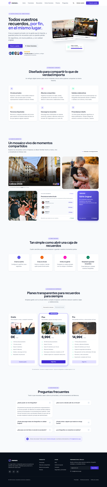
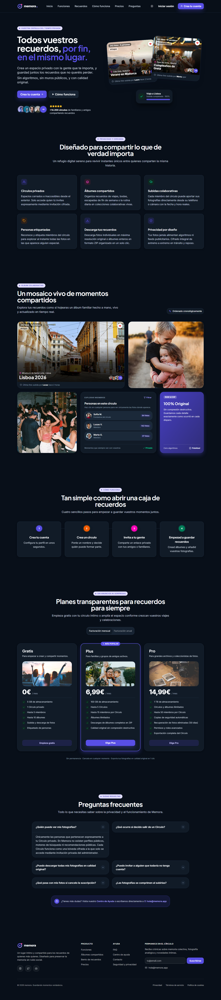

# Memora · Laboratorio Módulo 01 (Layout + Tailwind CSS)

Landing page de **Memora** maquetada con **Tailwind CSS v4** y **daisyUI 5**, responsive (móvil → escritorio) y con modo claro / oscuro.

## 1. Tema elegido: 🅱️ UI del TFM

**Memora** es una aplicación para guardar y compartir fotos en **círculos privados**: espacios cerrados donde solo entra la gente a la que invitas (familia, amigos, un viaje…). Sin algoritmos, sin muros públicos y con las fotos en calidad original.

En este laboratorio he maquetado la **landing del producto**: cabecera, hero, funciones, mosaico de recuerdos (bento), cómo funciona, precios, preguntas frecuentes y pie con newsletter. Solo maquetación: los datos son inventados y no hay backend.

## 2. Cómo arrancarlo

```bash
npm install
npm run dev
```

Para la versión de producción: `npm run build` y `npm run preview`.

## 3. Integración de Tailwind: plugin de Vite

He usado **`@tailwindcss/vite`** ([vite.config.js](vite.config.js)) porque:

- Es la opción más sencilla: un plugin y listo, sin `postcss.config.mjs`.
- Va integrado en el pipeline de Vite, así que la recarga en caliente es más rápida.
- No necesito otros plugins de PostCSS (en v4 tampoco hace falta `autoprefixer`).

Toda la configuración está **en el CSS**, como pide la v4: `@import "tailwindcss"` en [main.css](src/styles/main.css) y el tema con `@theme` en [tokens.css](src/styles/tokens.css). No hay `tailwind.config.js`.

### Organización del CSS

| Archivo                                     | Qué contiene                                                                                                                                                                      |
| ------------------------------------------- | --------------------------------------------------------------------------------------------------------------------------------------------------------------------------------- |
| [tokens.css](src/styles/tokens.css)         | Variables `--memora-*` (claro y oscuro) y `@theme`, que las convierte en clases (`bg-brand-600`, `text-fg`, `shadow-brand`…). También la animación `fade-up` y la variante `dark` |
| [main.css](src/styles/main.css)             | Entrada: Tailwind, daisyUI con los colores de Memora y estilos base                                                                                                               |
| [components.css](src/styles/components.css) | Las pocas piezas que se repiten en el HTML sin plantilla (ver D4)                                                                                                                 |
| [utilities.css](src/styles/utilities.css)   | Utilidades propias con `@utility`                                                                                                                                                 |

Las secciones que aparecen una sola vez llevan las clases directamente en [index.html](index.html). Las piezas que se repiten (cards, acordeón, filas de miembros…) son funciones en [src/components/](src/components/) que reciben datos de [src/data/](src/data/) y llevan sus clases en la plantilla.

### daisyUI

Lo usamos durante el curso, así que lo he aprovechado aquí, siempre conectado a mis tokens (los temas `light` / `dark` de daisyUI leen las variables `--memora-*`):

| Componente                     | Dónde                                                                 |
| ------------------------------ | --------------------------------------------------------------------- |
| `btn`                          | Header, hero, precios, "Me gusta", newsletter, volver arriba          |
| `badge`                        | Chips de las cards de álbum, "Más popular", "RAW & EXIF", nº de fotos |
| `card`                         | Tarjeta "Viaje a Lisboa · 100%" del hero                              |
| `progress`                     | Barra de esa misma tarjeta                                            |
| `rating` + `mask`              | Estrellas del hero                                                    |
| `avatar`, `avatar-group`       | Avatares del hero y de las cards de álbum                             |
| `collapse` (sobre `<details>`) | Preguntas frecuentes                                                  |
| `tabs` (radios)                | Selector de facturación mensual / anual                               |
| `input`                        | Campo de la newsletter                                                |

## 4. Capturas

| Móvil (390 px)                                                                                | Escritorio (1440 px)                                                                                    |
| --------------------------------------------------------------------------------------------- | ------------------------------------------------------------------------------------------------------- |
|    |    |
|  |  |

### Lighthouse

Sobre la versión de producción (`npm run build` + `npm run preview`), en modo claro y oscuro:

|            | Rendimiento | Accesibilidad | Buenas prácticas | SEO     |
| ---------- | ----------- | ------------- | ---------------- | ------- |
| Móvil      | 89          | **100**       | **100**          | **100** |
| Escritorio | 98-99       | **100**       | **100**          | **100** |

En móvil, el rendimiento baja sobre todo por el tiempo de primera pintura (las fuentes de Google Fonts bloquean el renderizado).

## 5. Checklist

### ✅ Obligatorios

- [x] **O1 · Estructura semántica**: `header`, `nav`, `main`, `section` con su `h2`, `footer`. Un solo `h1`, sin saltos de nivel. Cards en `<article>`, listas de enlaces en `<ul>`, todas las imágenes con `alt`.
- [x] **O2 · `@theme`**: marca `brand` (50-900), acentos `pink`, `peach` y `mint`, tipografía _Plus Jakarta Sans_ para títulos e _Inter_ para texto. Ningún color a pelo: hasta las estrellas (`bg-rating`) y el corazón (`text-heart`) son tokens.
- [x] **O3 · Cabecera con flexbox**: logo a la izquierda, menú y acciones a la derecha. En móvil el menú pasa a un panel desplegable. Enlaces con `hover:` y `focus-visible:`.
- [x] **O4 · Hero**: titular, texto (`max-w-xl`), dos botones e imagen. Una columna en móvil y `md:grid-cols-[5fr_6fr]` desde `md:`. Uso grid y no flex porque quiero controlar la proporción exacta de las dos columnas.
- [ ] **O5 · Rejilla de tarjetas**: cumplido en parte (ver nota).
- [x] **O6 · Pasos con flexbox**: "Cómo funciona" (4 pasos) con `flex flex-col md:flex-row` y el contenido de cada paso centrado.
- [x] **O7 · Pie**: 4 bloques en escritorio (marca, producto, ayuda, newsletter) que se apilan en móvil. Copyright separado con `border-t`.
- [x] **O8 · Accesibilidad**: todo se usa con teclado y tiene `focus-visible` visible. Lighthouse 100 en accesibilidad, en claro y en oscuro.
- [x] **O9 · README + bitácora**

> **Nota sobre O5.** Las tarjetas de **precios** tienen imagen (`aspect-2/1` + `object-cover`), título, texto, precio, botón y hover con `transition`. Las de **funciones** son 6, en grid de 2 y 3 columnas. Ninguna de las dos secciones cumple todo a la vez: los precios son 3 tarjetas, y las funciones no tienen imagen ni precio porque en el diseño de Memora son tarjetas informativas. Probé a añadir foto, dato y botón a las funciones, pero la sección dejaba de tener sentido, así que preferí mantener el diseño, dividiendo los requisitos.

### ⭐ Opcionales

- [x] **P1 · Modo oscuro con botón**: `@custom-variant dark` sobre `data-theme="dark"`. Al entrar sigue la preferencia del sistema y guarda la elección en `localStorage`.
- [x] **P2 · Cabecera fija con efecto cristal**: `sticky top-0 z-50 backdrop-blur-glass bg-glass` (explicación abajo).
- [x] **P3 · Plan destacado**: "Plus" con borde de marca, sombra de color y etiqueta "Más popular" colocada con `absolute` sobre la tarjeta (`relative` en el padre).
- [x] **P4 · FAQ sin JavaScript**: `<details>` + `<summary>`, con la flecha girando gracias a `group` + `group-open:rotate-180`.
- [x] **P5 · Formulario con estados**: newsletter con `<label>`, `focus:`, `user-invalid:`, `disabled:` y un mensaje de error con `peer` + `peer-user-invalid:block`.
- [x] **P6 · Bento grid**: mosaico de recuerdos con `lg:grid-cols-12` y `col-span-*` de distintos tamaños.
- [x] **P7 · Animaciones**: entrada del hero con una animación propia (`animate-fade-up`, definida en `@theme`) en cascada, más hovers en botones, tarjetas y fotos. Todo lo que se mueve lleva `motion-safe:`.

### 🔥 Desafíos

- [ ] **D1 · Menú hamburguesa sin JS**: hay menú hamburguesa, pero usa un poco de JS para gestionar `aria-expanded`.
- [x] **D2 · Container queries** (explicación abajo).
- [ ] **D3 · Multitema**
- [x] **D4 · Utilidades propias** (explicación abajo).
- [ ] **D5 · Layout de aplicación**
- [ ] **D6 · De captura a código**
- [x] **D7 · Lighthouse**: 100 en Accesibilidad, Buenas prácticas y SEO. Rendimiento de 98-99 en escritorio y 89 en móvil, con `loading="lazy"` y `width`/`height` en las imágenes.

## Explicaciones

### P2 · ¿Por qué `sticky` y no `fixed`? ¿Por qué `z-50`?

- **`sticky`** mantiene el header **dentro del flujo**: ocupa su sitio al principio y solo se queda pegado arriba al hacer scroll. Con **`fixed`** el header sale del flujo y el contenido se mete por debajo; habría que compensarlo con un `padding-top` en el `body`.
- **`z-50`**: el header es un elemento posicionado y el contenido que pasa por debajo también crea capas (cards con `relative`, transformaciones, la tarjeta girada del hero…). Sin un `z-index` más alto, esas capas se pintarían **encima** del header al hacer scroll.

El botón "Volver arriba" sí usa `fixed`, porque tiene que estar siempre en la misma esquina de la ventana, no en un sitio del documento.

### D2 · Container queries

La card de álbum ([circleMainCard.js](src/components/cards/circleMainCard.js)) lleva `@container` y cambia según **su propio ancho**, no el de la ventana:

- **Estrecha** (las dos cards giradas del hero): foto vertical, título pequeño, sin ubicación.
- **Media** (`@card:`, desde 13rem, un tamaño propio definido en `@theme`): foto 4:3, título más grande, con ubicación.
- **Ancha** (`@lg:`, el álbum "Lisboa 2026" del bento): foto panorámica y título grande.

Es la **misma función con los mismos datos**, colocada en una columna estrecha (hero) y en una ancha (bento).

### D4 · Utilidades propias y `@apply`

En [utilities.css](src/styles/utilities.css) hay dos `@utility`:

- `section-spacing`: el padding vertical de todas las secciones (`py-12 md:py-20 lg:py-28`).
- `scrollbar-none`: oculta la barra de scroll del carrusel de funciones en móvil, algo que Tailwind no trae.

**¿Cuándo crear una utilidad o componente en CSS y cuándo repetir clases?**

- Si algo se usa **una vez**, las clases van en el HTML: se lee todo en un sitio y no hay que inventar nombres.
- Si se repite y lo genera **una plantilla JS** (cards, acordeón…), las clases van en la plantilla: el componente ya es la abstracción.
- Solo creo una clase en CSS cuando se repite **en HTML estático sin plantilla**: `pill`, `section-header`, `nav-link`, `footer-link`, `surface-card` y `container-content` ([components.css](src/styles/components.css)).
- `@utility` tiene sentido para cosas que Tailwind no trae (`scrollbar-none`) o para un valor de diseño que quiero cambiar en un solo sitio (`section-spacing`).

**¿Por qué abusar de `@apply` es mala práctica?** Porque deshace lo que aporta Tailwind: vuelves a inventar nombres de clases, a saltar entre HTML y CSS para entender un elemento y a acumular CSS que nadie se atreve a borrar. Además, las clases con `@apply` pierden las variantes en el HTML (no puedes poner `md:` a una clase propia sin definirla) y los conflictos de cascada son más difíciles de ver. En una primera versión maqueté casi todo con `@apply` y lo deshice por estos motivos (ver bitácora).

## 🤖 Bitácora de IA

**Herramientas:** Claude Code (en VS Code) para revisar, refactorizar y pasar Lighthouse. Las decisiones y correcciones de diseño son mías.

### 1. Adaptar una sección al punto O5

#### Prompt

"Se supone que las cards de 'funciones', 'cómo funciona' o 'precios' ya estaban pensadas para cubrir este punto. ¿Podrías cambiar una de estas secciones para que encaje con lo que se pide, sin estropear nada?"

#### Qué me dio

Eligió "Funciones" y le añadió a cada tarjeta una foto de stock, un "dato destacado" (_"1 clic para ver las fotos de alguien"_, _"0 anuncios y algoritmos"_…) y un botón que llevaba a otra sección. Cumplía el checklist, pero el contenido era forzado y la sección dejaba de tener sentido.

#### Qué corregí y por qué

Le pedí que lo deshiciera. Prefiero no cumplir un punto al 100 % antes que tener una web incoherente. Después probé por mi cuenta a poner **solo una imagen** en las tarjetas de precios, que sí encajaba con el diseño, y la ajusté: más baja (`aspect-2/1`) y uniendo dos líneas del plan Pro para que las tarjetas no crecieran tanto.

### 2. Quitar el abuso de `@apply`

#### Prompt

"¿Cómo podrías maquetarlo entonces si no usas `@apply`? Supongo que podrías usar sencillamente esas clases de Tailwind en el propio componente en caso de que ese componente no se repita. Hazlo. Que quede ordenado y presentable."

#### Qué me dio

En mi primera versión casi toda la maquetación estaba en clases BEM con `@apply` (`.site-header`, `.pricing-card__badge`…). Lo reorganizó con el criterio de la sección D4: clases en el HTML para lo que sale una vez, en la plantilla JS para lo que se repite y en CSS solo para lo repetido en HTML estático. Pasó selectores como `.member-row[aria-pressed="true"]` a variantes (`aria-pressed:`, `group-aria-pressed:`, `data-[open=true]:`) y los tonos de color a un mapa en [tones.js](src/components/ui/tones.js).

#### Qué corregí y por qué

Revisé que el JS ya no dependiera de clases de estilo (ahora usa atributos como `data-press-toggle` o `data-monthly`) y que no quedaran colores de la paleta por defecto: `bg-amber-400` y `text-red-500` pasaron a tokens (`bg-rating`, `text-heart`).

### 3. Hover de las tarjetas de precios

#### Prompt

"Mete un hover a las cards de precios que haga que se ponga una sombra de color por debajo, similar a la de 'Plus', pero algo más amplia."

#### Qué me dio

Un token nuevo `shadow-brand-lg` y `transition-shadow duration-300 ease-out hover:shadow-brand-lg`. La sombra aparecía demasiado de golpe.

#### Qué corregí y por qué

Pedí un efecto más suave: `transition-[box-shadow,translate] duration-500 ease-standard` (la curva de mi sistema de diseño) y una pequeña subida con `motion-safe:hover:-translate-y-1`. Lleva `motion-safe:` porque es movimiento y hay que respetar `prefers-reduced-motion`.

### 4. La primera fila del bento se estiraba

#### Prompt

"En el bento, ¿podrías hacer que la primera fila no tuviera tanta altura? La primera card se está estirando de manera rara."

#### Qué me dio

Detectó que no era culpa de la card: la foto de la derecha tenía `lg:aspect-auto`, así que su altura la marcaba la propia imagen (cuadrada, 800×800). Eso alargaba toda la fila del grid, y la card, que tiene `h-full`, se estiraba con ella.

#### Qué corregí y por qué

En escritorio la imagen pasa a `lg:absolute lg:inset-0` dentro de un `figure` con `relative`. Así no aporta altura, la fila mide lo que la card y la foto rellena ese hueco con `object-cover`. Lo apliqué también a la otra foto del bento para que no ocurriera lo mismo en la segunda fila.

### 5. Lighthouse en modo oscuro

#### Prompt

"¿Podrías pasar el Lighthouse?"

#### Qué me dio

Accesibilidad 97 y SEO 83. Fallaban el contraste del botón "Filtrar" **solo en modo oscuro** (`text-brand-600` sobre fondo oscuro: 3:1, cuando el mínimo es 4,5:1), la falta de `<meta name="description">` y que no había `robots.txt`.

#### Qué corregí y por qué

Añadí `dark:text-brand-300` al botón, la meta description y [public/robots.txt](public/robots.txt). Al volver a pasarlo, en claro y en oscuro, quedó en 100 en Accesibilidad, Buenas prácticas y SEO. Aprendí que hay que pasar Lighthouse **en los dos modos**: en claro todo estaba bien.
